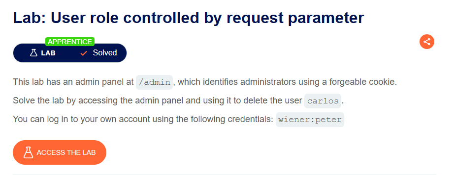
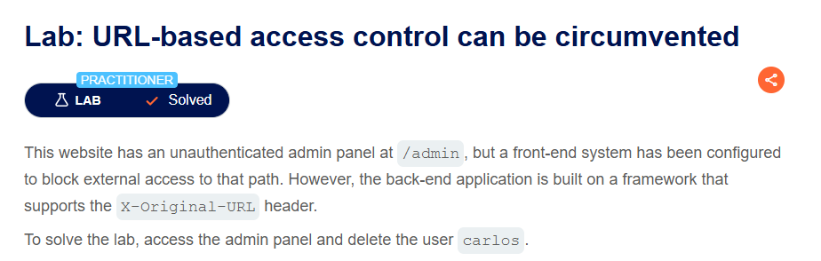
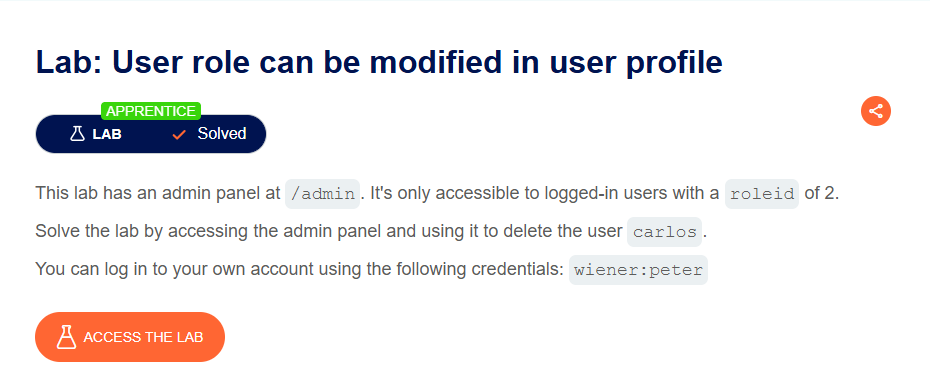

qwe

---

## 🧪 Lab Walkthroughs & Practical Proofs

### 1. Lab: Unprotected admin functionality

- **Platform:** PortSwigger Web Security Academy
- **Difficulty:** Apprentice
- **Target Goal:** Delete the user `carlos` by accessing the unprotected administrative panel.

#### 🎯 Vulnerability Analysis
The web application relies on URL obfuscation rather than robust server-side authorization controls to protect administrative endpoints. Exposing sensitive routes in public metadata (e.g., `robots.txt`) allows unauthenticated users to discover and interact with privileged administrative features.

#### 🚀 Proof of Concept (PoC) & Exploitation Steps
1. Navigated to `/robots.txt` in the browser to inspect search engine crawler directions.
2. Discovered a restricted route defined under the `Disallow:` directive: `/administrator-panel`.
3. Navigated directly to `/administrator-panel` without providing administrative credentials.
4. Located the user management control panel and clicked the delete trigger for user `carlos`.
5. Confirmed the successful execution of the endpoint: `GET /administrator-panel/delete?username=carlos`.

#### 📸 Proof of Completion

---

### 2. Lab: Unprotected admin functionality with unpredictable URL

- **Platform:** PortSwigger Web Security Academy
- **Difficulty:** Apprentice
- **Target Goal:** Access the hidden administrative panel located at an unpredictable URL and delete user `carlos`.

#### 🎯 Vulnerability Analysis
The application relies on "Security through Obscurity" by assigning a randomized string to the administrative URL path. However, the client-side JavaScript file leaks this endpoint directly within a conditional rendering logic (`isAdmin`), allowing unauthenticated users to inspect the DOM source and locate the hidden route.

#### 🚀 Proof of Concept (PoC) & Exploitation Steps
1. Inspected the HTML source code of the main application landing page.
2. Analyzed embedded client-side JavaScript (`<script>` block) and discovered a conditional check for `isAdmin`.
3. Extracted the dynamically attached administrative endpoint: `/admin-3oi6i9`.
4. Navigated directly to `/admin-3oi6i9` without administrative privileges.
5. Executed the deletion request for target account `carlos`.

#### 📸 Proof of Completion

---

### 3. Lab: User role controlled by request parameter

- **Platform:** PortSwigger Web Security Academy
- **Difficulty:** Apprentice
- **Target Goal:** Bypass access controls via cookie manipulation to access `/admin` and delete user `carlos`.

#### 🎯 Vulnerability Analysis
The application relies on a client-side modifiable HTTP cookie (`Admin=false`) to determine user privilege levels instead of validating the user's role securely on the server side or using cryptographically signed tokens (e.g., JWT, HMAC).

#### 🚀 Proof of Concept (PoC) & Exploitation Steps
1. Attempted direct navigation to `/admin` and observed access denial.
2. Logged in using the provided standard user credentials (`wiener:peter`).
3. Intercepted the HTTP authentication response using Burp Suite Proxy.
4. Identified the `Set-Cookie: Admin=false` header in the HTTP response.
5. Tampered with the cookie value by changing `Admin=false` to `Admin=true`.
6. Navigated to `/admin` with the manipulated cookie, successfully gaining administrator access to delete user `carlos`.

#### 📸 Proof of Completion

---

### 4. Lab: User role can be modified in user profile

- **Platform:** PortSwigger Web Security Academy
- **Difficulty:** Apprentice
- **Target Goal:** Escalate privileges by tampering with profile JSON parameters, gain access to `/admin`, and delete user `carlos`.

#### 🎯 Vulnerability Analysis
The application suffers from a mass assignment flaw where the backend blindly binds untrusted JSON request parameters directly to the user model during profile update operations. Because authorization checks do not filter restricted parameters, an attacker can append administrative fields (`"roleid": 2`) to elevate their privilege level.

#### 🚀 Proof of Concept (PoC) & Exploitation Steps
1. Logged in using the provided credentials (`wiener:peter`) and accessed the account details page.
2. Triggered an email update request and intercepted the HTTP traffic in Burp Suite.
3. Observed that the server response returned account metadata including `"roleid": 1`.
4. Forwarded the email submission request to Burp Repeater and added `"roleid": 2` into the JSON payload body.
5. Resent the modified HTTP POST request and verified in the response that `roleid` successfully updated to `2`.
6. Navigated directly to `/admin` and executed the administrative function to delete user `carlos`.

---

### 5. Lab: URL-based access control can be circumvented

- **Platform:** PortSwigger Web Security Academy
- **Difficulty:** Practitioner
- **Target Goal:** Circumvent front-end URL access controls using custom HTTP override headers to access `/admin` and delete user `carlos`.

#### 🎯 Vulnerability Analysis
The infrastructure utilizes a front-end system (e.g., reverse proxy or WAF) to block external access to specific URL paths such as `/admin`. However, the back-end web framework supports HTTP request routing override headers like `X-Original-URL`. Because the front-end fails to validate or strip custom routing headers, an attacker can send requests to an allowed path (`/`) while forcing the back-end framework to process the internal route (`/admin`).

#### 🚀 Proof of Concept (PoC) & Exploitation Steps
1. Attempted direct HTTP access to `/admin` and observed an immediate access block from the front-end system.
2. Sent the HTTP request to Burp Repeater and changed the request line target path to `/`.
3. Injected the custom HTTP header `X-Original-URL: /invalid` and confirmed that the back-end returned a 404 Not Found response, proving header parsing support.
4. Updated the header value to `X-Original-URL: /admin` and successfully loaded the administrator dashboard.
5. Constructed the account deletion request by targeting `/?username=carlos` on the request line while setting `X-Original-URL: /admin/delete`, successfully deleting user `carlos`.

#### 📸 Proof of Completion

#### 📸 Proof of Completion

