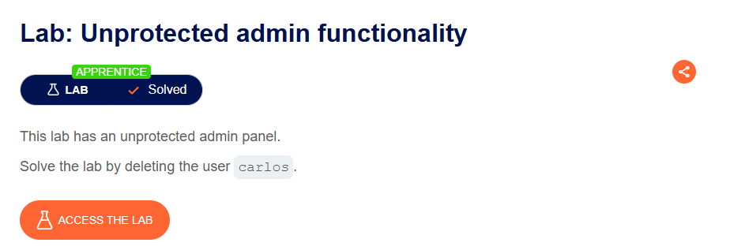
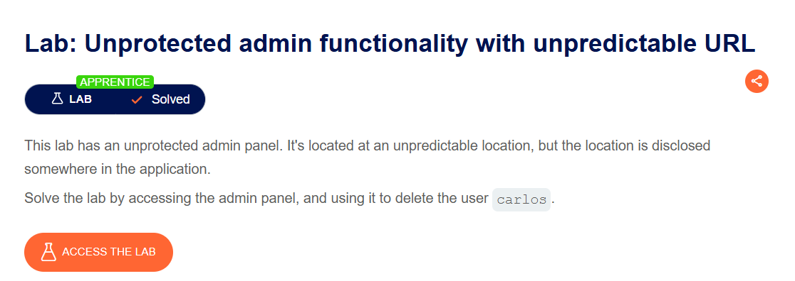

qwe

---

## 🧪 Lab Walkthroughs & Practical Proofs

### 1. Lab: Unprotected admin functionality

- **Platform:** PortSwigger Web Security Academy
- **Difficulty:** Apprentice
- **Target Goal:** Delete the user `carlos` by accessing the unprotected administrative panel.

#### 🎯 Vulnerability Analysis
The web application relies on URL obfuscation rather than robust server-side authorization controls to protect administrative endpoints. Exposing sensitive routes in public metadata (e.g., `robots.txt`) allows unauthenticated users to discover and interact with privileged administrative features.

#### 🚀 Proof of Concept (PoC) & Exploitation Steps
1. Navigated to `/robots.txt` in the browser to inspect search engine crawler directions.
2. Discovered a restricted route defined under the `Disallow:` directive: `/administrator-panel`.
3. Navigated directly to `/administrator-panel` without providing administrative credentials.
4. Located the user management control panel and clicked the delete trigger for user `carlos`.
5. Confirmed the successful execution of the endpoint: `GET /administrator-panel/delete?username=carlos`.

#### 📸 Proof of Completion

---

### 2. Lab: Unprotected admin functionality with unpredictable URL

- **Platform:** PortSwigger Web Security Academy
- **Difficulty:** Apprentice
- **Target Goal:** Access the hidden administrative panel located at an unpredictable URL and delete user `carlos`.

#### 🎯 Vulnerability Analysis
The application relies on "Security through Obscurity" by assigning a randomized string to the administrative URL path. However, the client-side JavaScript file leaks this endpoint directly within a conditional rendering logic (`isAdmin`), allowing unauthenticated users to inspect the DOM source and locate the hidden route.

#### 🚀 Proof of Concept (PoC) & Exploitation Steps
1. Inspected the HTML source code of the main application landing page.
2. Analyzed embedded client-side JavaScript (`<script>` block) and discovered a conditional check for `isAdmin`.
3. Extracted the dynamically attached administrative endpoint: `/admin-3oi6i9`.
4. Navigated directly to `/admin-3oi6i9` without administrative privileges.
5. Executed the deletion request for target account `carlos`.

#### 📸 Proof of Completion

